# Learn MapLibre through this codebase

A hands-on tour of how the Halloween map (the Spaces app) uses MapLibre GL JS, written for someone who
has not used it before. Every explanation points at real code in this repo, every picture is a
screenshot of the running app, and the last section is a set of exercises where you change one thing
and watch what happens.

> **Versions this was written against:** `maplibre-gl` 6.9.0 · `@vis.gl/react-maplibre` 8.1.3 ·
> `pmtiles` 4.5.0 · `@protomaps/basemaps` 5.7.2. Line numbers are as of that commit; search for the
> function name if they have drifted.

## Contents

1. [Set up in five minutes](#1-set-up-in-five-minutes)
2. [The mental model](#2-the-mental-model)
3. [Our stack, in one table](#3-our-stack-in-one-table)
4. [Tour 1 — the data: one `.pmtiles` file](#4-tour-1--the-data-one-pmtiles-file)
5. [Tour 2 — the style: what to draw and how](#5-tour-2--the-style-what-to-draw-and-how)
6. [Tour 3 — the map component and the camera](#6-tour-3--the-map-component-and-the-camera)
7. [Tour 4 — markers, popups, and the fixed centre pin](#7-tour-4--markers-popups-and-the-fixed-centre-pin)
8. [Tour 5 — what has to happen around MapLibre](#8-tour-5--what-has-to-happen-around-maplibre)
9. [Things that went wrong (and what they teach)](#9-things-that-went-wrong-and-what-they-teach)
10. [Exercises](#10-exercises)
11. [Appendix — how the pictures were made, further reading](#11-appendix)

---

## 1. Set up in five minutes

```bash
pnpm backend:up                                   # Postgres + API in Docker
(cd backend && SEED_SPACE_PARTICIPANT_EMAIL=you@example.com pnpm seed:space)   # once
pnpm dev                                          # https://localhost:3000/
```

Open the Spaces app and enter the email you seeded. In dev the sign-in form **signs you straight in**
(the API returns a `devToken` and `MapHomePage.tsx` uses it), so there is no email step.

Useful while you read:

- Open browser DevTools → **Network**, filter by `halloween-trick-o-treating-opt-in/`, and reload. You will see the requests
  described in [Tour 5](#8-tour-5--what-has-to-happen-around-maplibre).
- The map's canvas is keyboard-focusable. Click the map once, then use the **arrow keys** to pan and
  **`+` / `-`** to zoom. That is MapLibre's built-in keyboard handler, and it is why our pin placement
  works without a mouse.

---

## 2. The mental model

A MapLibre map is four things working together:

| Piece | What it is | In this app |
|---|---|---|
| **Tiles** | Small chunks of map *data* (geometry + attributes, not pictures) for one square of the world at one zoom level | one file: `public/spaces/tiles/meckenhausen-v1.pmtiles` |
| **Style** | A JSON document: which **sources** to read and which **layers** to draw from them, plus where to find **glyphs** (fonts) and a **sprite** (icons) | `space-map-style.ts` |
| **Worker** | A background thread that decodes tiles and turns them into GPU-ready buffers so the page never stutters | `maplibre-gl-worker.mjs` |
| **Canvas** | A WebGL `<canvas>` the result is painted on, driven by a **camera**: centre, zoom, bearing, pitch | `<MapLibreMap>` in `SpaceMap.tsx` |

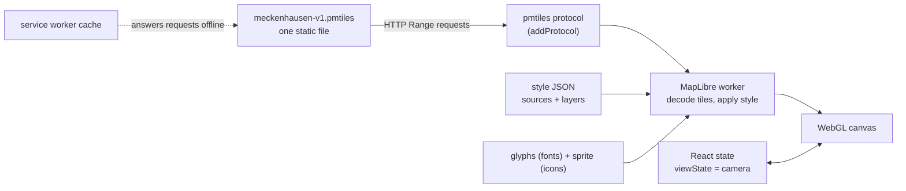

Two facts to hold on to:

1. **Vector tiles are data, the style is the paint.** The same tiles can look completely different
   with a different style (see the [dark and grayscale pictures](#tour-2-experiments)). Changing how
   the map looks never needs new tiles.
2. **Coordinates are `[longitude, latitude]` in MapLibre** (x, y), the opposite of how people say
   "lat, lng". Our own domain code uses `lat`/`lng` names precisely to avoid mixing them up; the two
   meet in places like `MECKENHAUSEN_BOUNDARY_RING`, which is written `[lng, lat]` because GeoJSON
   is (`frontend/domain/space/meckenhausen-boundary.ts`).

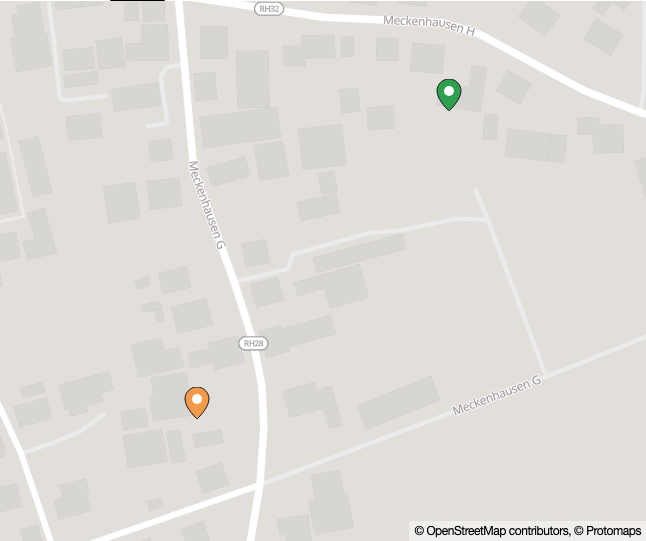

*Everything in this picture — streets, buildings, labels, the school icon, the pins — was produced
by the four pieces above, all served from our own origin. No request left the app and the API
(there is an end-to-end test that fails if one does).*

---

## 3. Our stack, in one table

| Package | Role | Where you meet it |
|---|---|---|
| `maplibre-gl` | The map engine (open-source fork of Mapbox GL JS) | `addProtocol`, `setWorkerUrl`, style types |
| `@vis.gl/react-maplibre` | React bindings: `<Map>`, `<Marker>`, `<Popup>` | `SpaceMap.tsx`, `LocationsMapView.tsx` |
| `pmtiles` | Reads tiles out of a single `.pmtiles` file using HTTP Range requests, so no tile server is needed | `space-map-style.ts` (`Protocol`) |
| `@protomaps/basemaps` | Generates the ~70 style layers for Protomaps' tile schema, in colour "flavors" | `pmtilesStyle()` |
| `go-pmtiles` (CLI, not a dependency) | Cuts our village out of the world tile file | `scripts/build-tiles.sh` |

---

## 4. Tour 1 — the data: one `.pmtiles` file

`scripts/build-tiles.sh` asks Protomaps for their latest daily world build and **extracts just our
bounding box** (plus ~300 m of margin):

```bash
pmtiles extract https://build.protomaps.com/20260923.pmtiles meckenhausen-v1.pmtiles --bbox=…
```

Result: a **2.1 MB** file with **69 tiles**. Ask the file about itself:

```console
$ pmtiles show public/tiles/meckenhausen-v1.pmtiles
pmtiles spec version: 3
tile type: mvt                      ← Mapbox Vector Tiles: geometry + attributes
bounds: (11.266078, 49.148827) (11.312078, 49.194827)
min zoom: 0
max zoom: 15                        ← the most detailed tiles that exist
addressed tiles count: 69
```

It contains nine **vector layers** (the "source layers" your style will refer to by name):
`boundaries`, `buildings`, `earth`, `landcover`, `landuse`, `places`, `pois`, `roads`, `water`
(each with attributes like `kind`, `name`, `name:de`, `height`, `addr_housenumber` …).

**Why one static file works:** `.pmtiles` has an index at the front. The `pmtiles` library reads the
index, then fetches *only the bytes of the tiles on screen* with `Range: bytes=…` requests. Any static
host (GitHub Pages, Caddy, the Vite dev server) can serve that — no tile server, no database.

### Zoom levels and "overzoom"

The camera zoom is continuous; every whole number doubles the scale. The archive's data stops at
**zoom 15**, so what happens beyond that? MapLibre keeps the z15 geometry and *scales it up* ("overzoom") — vector data stays crisp:

| ≈ zoom 13.5 (as far out as `maxBounds` allows) | zoom 15 | zoom 17 | zoom 19 |
|---|---|---|---|
| 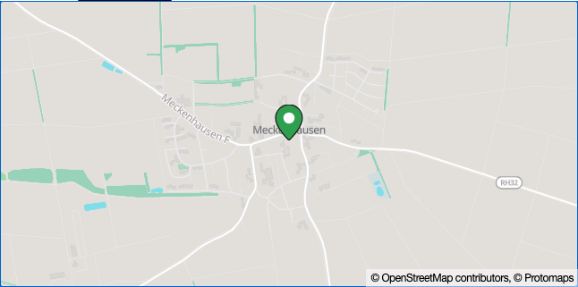 | 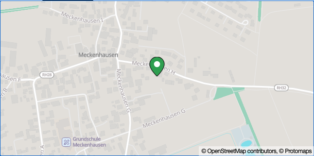 | 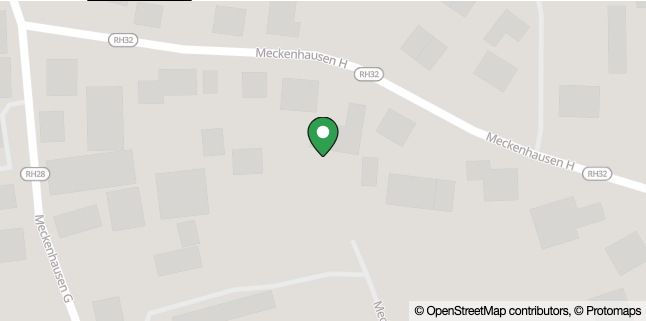 | 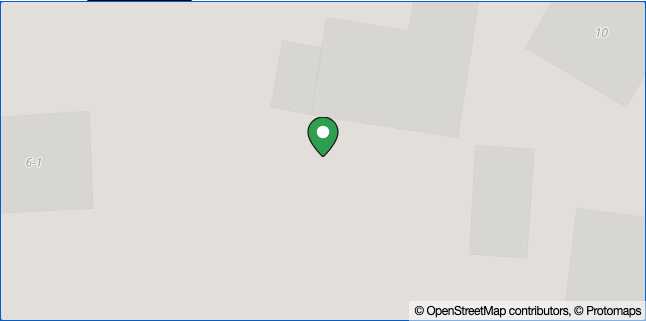 |

Notice what appears as you zoom in: the place name first, then road names and the school icon, then
individual buildings, and finally **house numbers** — the `address_label` layer (it reads the
`addr_housenumber` attribute of `buildings`) has `minzoom: 18`, so they only appear from zoom 18. Every
style layer declares the zoom range where it is shown; that is why the map is not a cluttered mess when
zoomed out.

### Where the data ends

Tiles only exist for our box. If we removed the `maxBounds` restriction and zoomed out, the world
would simply run out (left) — and our own boundary rectangle, drawn by the placeholder style, would
appear (right):

| Real style, `maxBounds` removed | Placeholder style, `maxBounds` removed |
|---|---|
| 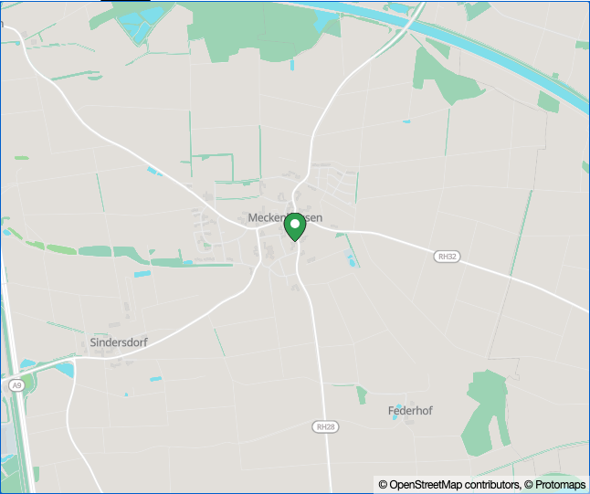 | 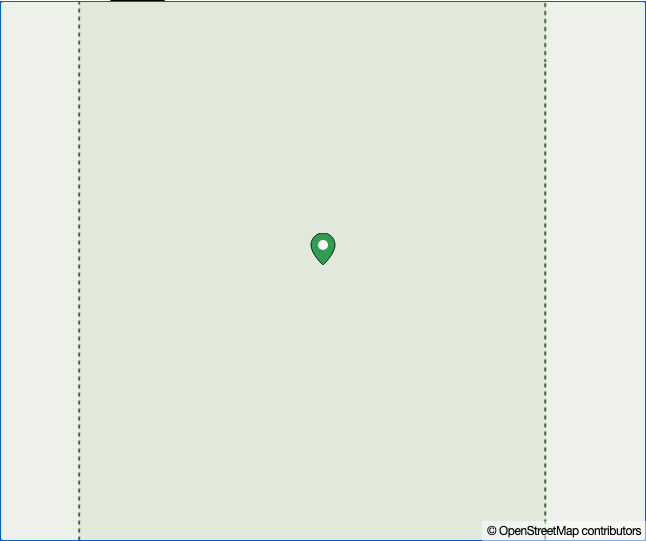 |

*(Notice the neighbouring villages — Sindersdorf, Federhof — and the A9 motorway: our 300 m margin
plus tile alignment gives a little more than the box.)*

---

## 5. Tour 2 — the style: what to draw and how

Open `frontend/infrastructure/tile-server/space-map-style.ts`. A MapLibre style is just an object. Ours
is built by `pmtilesStyle()` (line ~84) and has five parts:

```ts
{
  version: 8,
  glyphs: spaceAssetUrl("fonts/{fontstack}/{range}.pbf"),   // fonts, fetched per 256-character range
  sprite: spaceAssetUrl("sprite/sprite"),                   // icon sheet: sprite.json + sprite.png (+ @2x)
  sources: { protomaps: { type: "vector", url: "pmtiles://…/meckenhausen-v1.pmtiles" } },
  layers: layers("protomaps", namedFlavor("light"), { lang }),   // ← 71 layers, generated
}
```

- **`sources`** say *where data comes from*. The `pmtiles://` prefix is a custom protocol we
  registered (`registerPmtilesProtocol()`, line ~17) so MapLibre hands those URLs to the `pmtiles`
  library instead of `fetch`.
- **`layers`** say *what to draw*, in order (later = on top). Each layer names a `source`, a
  `source-layer` inside it, a `type` (`fill`, `line`, `symbol`, `background`…), an optional `filter`,
  and `paint`/`layout` properties. We don't hand-write them: `@protomaps/basemaps` generates them.
- **`glyphs`** are the fonts for text labels, pre-rendered into Protobuf files
  (`public/fonts/Noto Sans Regular/0-255.pbf` covers characters 0–255). We ship only the
  Latin ranges (1.7 MB instead of ~13 MB).
- **`sprite`** is a sheet of small icons (the school, parking, …) plus a JSON map of where each one is.

What are the 71 layers? Grouped by the tile layer they read:

| Source layer | Style layers | Examples |
|---|---:|---|
| `roads` | 41 | `roads_major`, `roads_minor`, `roads_bridges_*`, `roads_tunnels_*_casing`, labels |
| `landuse` | 11 | `landuse_park`, `landuse_school`, `landuse_hospital`, … |
| `water` | 6 | `water`, `water_stream`, `water_river`, labels |
| `places` | 4 | `places_locality`, `places_subplace`, … (village names) |
| `earth`, `buildings`, `boundaries` | 2 each | `buildings` (the grey blocks), `address_label` (house numbers) |
| `pois`, `landcover`, *(background)* | 1 each | `pois` (the school icon) |

### The fallback style

`placeholderStyle()` (line ~42) is a *different, tiny* style: a background, and our boundary polygon
as a GeoJSON source with a fill and a dashed outline. No tiles, no fonts, no sprite → **zero
network requests**. `SpaceMap.tsx` uses it when the tile file is not reachable:

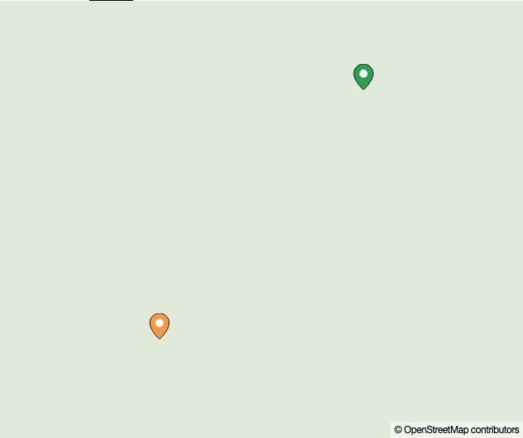

### Tour 2 experiments

The same tiles, different paint — changing one word or one line in `pmtilesStyle()`:

| `namedFlavor("dark")` | `namedFlavor("grayscale")` | layers filtered to drop `buildings` |
|---|---|---|
| 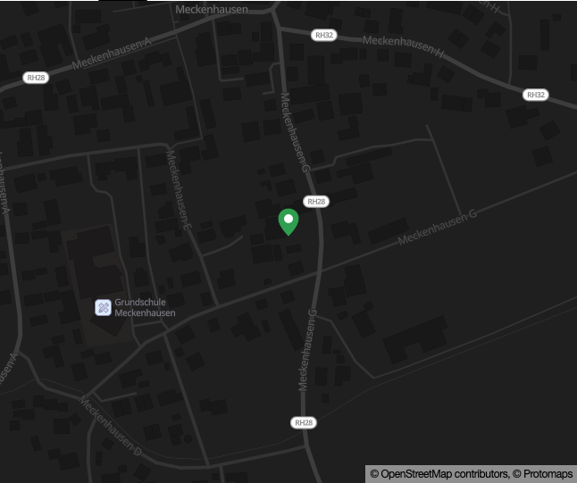 | 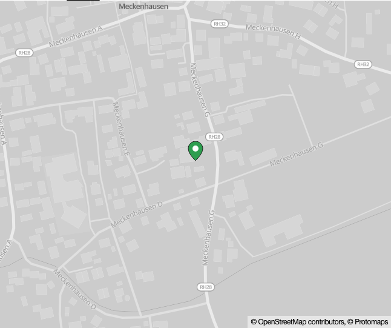 | 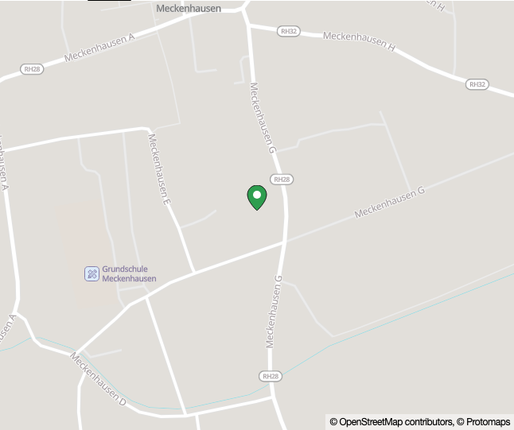 |

(The last one is
`layers(…).filter((l) => !l.id.startsWith("buildings"))` — the buildings are gone but the house-number
labels and everything else remain, because they are separate layers.)

Also notice `{ lang }` in the `layers()` call: `SpaceMap.tsx` passes `"de"` or `"en"` from the app's
i18n setting, and labels switch to the `name:de` / `name:en` attributes in the tiles.

---

## 6. Tour 3 — the map component and the camera

Open `frontend/ports/pages/space/SpaceMap.tsx`. It is one wrapper used by both map screens:

```tsx
<MapLibreMap
  mapStyle={mapStyle}                       // the object from tour 2
  longitude={viewState.longitude}           // ┐
  latitude={viewState.latitude}             // ├ the CAMERA
  zoom={viewState.zoom}                     // ┘
  minZoom={13}  maxZoom={19}
  maxBounds={MECKENHAUSEN_MAX_BOUNDS}       // [west, south, east, north] — can't leave the village
  dragRotate={false}                        // this is a flat map; no rotation gestures
  keyboard={interactive}                    // the arrow keys / +/- handler
  onMove={…}  onMoveEnd={…}
/>
```

### The one concept that bites: controlled vs uncontrolled

`react-maplibre` supports two styles:

- **Uncontrolled**: give it `initialViewState` once and forget it; the map owns its camera.
- **Controlled** (what we use): you pass `longitude`/`latitude`/`zoom`, **and you must update them in
  `onMove`**. If you pass them but never update them, every drag is snapped back — the map looks
  frozen.

We shipped exactly that bug: `LocationsMapView` passed a fixed camera with no `onMove`, so the main map
could not be panned or zoomed at all (the placement map worked, which hid it). It is now:

```tsx
const [viewState, setViewState] = useState(() => fitView(locations));   // LocationsMapView.tsx
<SpaceMap viewState={viewState} onMove={setViewState} … />
```

**Why controlled at all?** Because the pin placement screen *needs* the camera in React state: the
candidate coordinate **is** the camera centre.

### `maxBounds` does more than it sounds like

`maxBounds` constrains the **viewport**, not the centre. MapLibre won't let the visible rectangle
leave the box, so on a narrow map it also silently raises the minimum zoom (the "≈ 13.5" in the picture
above; we ask for `minZoom={13}` but a 646 px-wide map cannot fit the whole box at 13). It also means
you can never pan the *centre* outside the box — which is why the "outside the village" state is only
reachable through "Use my location" from elsewhere. (Today the boundary *is* that rectangle because
OpenStreetMap has no polygon for this hamlet; a real polygon later would make the two differ.)

### `onMove` vs `onMoveEnd`

`onMove` fires on every frame of a drag — perfect for keeping the camera in state, terrible for a
screen reader. `onMoveEnd` fires once when the gesture finishes; `PinPlacement` announces the new
position from it. (We shipped a bug here too: it announced only after the nudge buttons, so a drag left
the "inside/outside" text stale. `onMoveEnd` fixed it.)

`fitView()` (`frontend/domain/space/fit-view.ts`) is a small pure function worth reading: given the pins
it returns a centre and the highest zoom at which they all still fit, by solving
`world width = 512 · 2^zoom` pixels. It is fully unit-tested because no browser is needed.

---

## 7. Tour 4 — markers, popups, and the fixed centre pin

### Pins and popups (`LocationsMapView.tsx`)

```tsx
<Marker longitude={l.lng} latitude={l.lat} anchor="bottom">
  <button aria-label={l.label} aria-expanded={open} onClick={toggle}>
    <SpacePinIcon variant={mine ? "own" : "participant"} />
  </button>
</Marker>
{open && <Popup longitude={…} latitude={…} anchor="bottom" offset={28} closeOnClick={false}>
  <strong>{l.label}</strong><p style={PRE_WRAP}>{l.note}</p>
</Popup>}
```

- A `<Marker>` is an ordinary DOM element that MapLibre keeps positioned over the canvas. Because it is
  a real `<button>`, it is keyboard-focusable, has an accessible name, and works with Enter/Space —
  nothing custom.
- `anchor="bottom"` makes the *tip* of the pin sit on the coordinate (the default anchors the centre).
- **Text is always rendered as React children**, never as HTML. A pin labelled
  `` shows those characters literally; an end-to-end test proves it, and a static
  test fails the build if anyone adds `innerHTML`/`dangerouslySetInnerHTML`.

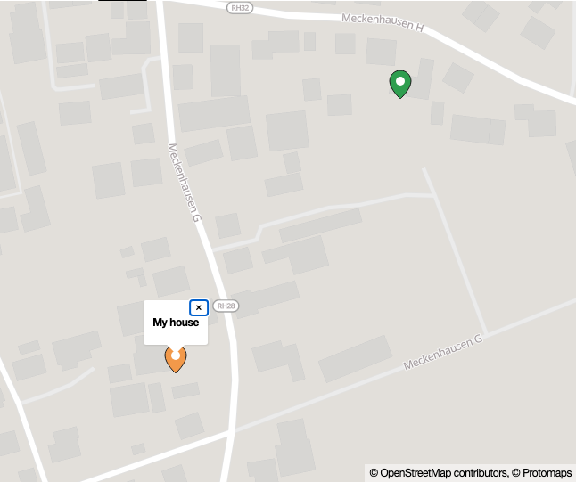

Two traps we hit here (both invisible in a quick look):

1. The popup never opened, because the click was handled **twice** — once by MapLibre's marker
   listener, once by our React `onClick` — and the two toggles cancelled out. **One handler.**
2. With one handler it worked for the keyboard but not the mouse: a mouse click on a marker is *also*
   a click on the map, and popups **close on map clicks by default** (`closeOnClick`). Fix:
   `closeOnClick={false}`.

### The fixed centre pin (`PinPlacement.tsx`)

The obvious way to let someone place a pin is a draggable marker. We did the opposite: the pin is a
fixed overlay at the centre of the map and the **map moves underneath it**.


Why:

- The coordinate you are choosing is simply the camera centre: `viewState.latitude/longitude`. No
  marker-drag events, no coordinate conversion, no "drag the pin *and* pan the map" conflict on touch.
- It works identically for **mouse** (drag the map), **touch** (pan/pinch; the canvas has
  `touch-action: none`), and **keyboard** (arrows pan, plus explicit nudge buttons that move 2 m).
- The overlay is a plain sibling `<div>` positioned at 50%/50% (`CENTER_MARKER` in
  `space-inline-styles.ts`) with `pointer-events: none` so it never steals a drag.

The pin turns green/red from `isInsideMeckenhausenBoundary(lat, lng)` — a hand-written ray-casting
point-in-polygon test (`frontend/domain/space/point-in-polygon.ts`), duplicated on the server
(`backend/src/domain/space/point-in-polygon.ts`) because **the server must never trust the client's
check**.

---

## 8. Tour 5 — what has to happen around MapLibre

MapLibre alone is not enough for a self-hosted, offline-capable map. These are the supporting pieces,
each of which was a real bug at some point:

| Piece | File | Why it exists |
|---|---|---|
| Register the `pmtiles://` protocol | `space-map-style.ts` `registerPmtilesProtocol()` | so a style can read a `.pmtiles` file |
| Tell MapLibre where its worker is | same function, `setWorkerUrl(…)` + `maplibreWorkerPlugin` in `vite.config.ts` | MapLibre 6 loads its worker as a separate `.mjs` next to its own file, which bundlers don't provide. Without it the map fetches tiles and **paints nothing** |
| Build absolute asset URLs | `frontend/infrastructure/space-assets/space-asset-url.ts` | `BASE_URL` has no trailing slash; string concatenation produced `/visual-directoryspaces/…`. MapLibre also *requires* sprite/glyph URLs to be absolute |
| Check the tile file exists | `SpaceMap.tsx` `usePmtilesAvailability()` | falls back to the placeholder. Must reject an HTML response: dev servers answer unknown paths with `index.html` and status 200 |
| Cache everything for offline | `public/sw.js` | see below |
| Strict CSP | `vite.config.ts` `spaceCspPlugin` | `worker-src 'self' blob:`, `img-src 'self' data: blob:`… "no third-party requests" is enforced by the browser |

### What the network does (first visit vs second visit)

Captured from the running app with the service worker (`sw.js`):

| Request | Visit 1 (worker installing) | Visit 2 (worker in control) |
|---|---|---|
| `maplibre/maplibre-gl-worker.mjs` (+ `-shared.mjs`) | 200 · service worker | 200 · service worker |
| `sprite/sprite.json`, `sprite.png` | 200 · service worker | 200 · service worker |
| `fonts/Noto Sans …/0-255.pbf` (×3) | 200 · service worker | 200 · service worker |
| `tiles/meckenhausen-v1.pmtiles` (Range) | **206** · service worker | **206** · service worker |
| API `GET /spaces/meckenhausen`, `/locations` | network | network |

Look at the tile row: the tile requests are `Range` requests, and **the service worker answers
them with `206 Partial Content`**. That works because `handleRangeableRequest` (in `sw.js`) downloads
the *whole* 2 MB file once, stores it, and then slices the requested byte range out of the stored copy
for every later request. Range requests cannot be cached by the normal Cache API, so this is the
trick that makes a Range-based format work offline.

The same file also does:

- **network-first for the HTML page** (`networkFirst`) so a new deploy reaches people, falling back to
  the cached page when offline;
- **cache-first for hashed build assets** under `/assets/` (`BUILD_ASSETS_PATH`) — safe
  because their filenames change when their content does;
- **nothing** for the API, non-GET requests, or other origins.

The offline behaviour has its own end-to-end test (`pnpm test:e2e:spaces:offline`): two online visits,
then the network is cut — the page, real tiles, village name and pins must all still work.

---

## 9. Things that went wrong (and what they teach)

Each of these shipped, was found by looking at the running app or by an end-to-end test, and is now
covered by a test. They are the fastest way to learn where MapLibre's edges are:

| # | Symptom | Cause | Lesson |
|---|---|---|---|
| 1 | Tiles/sprite/service worker all 404 | `BASE_URL` + `"spaces/…"` = `/visual-directoryspaces/…` (also in the **production** bundle) | Build URLs with one helper; never concatenate |
| 2 | Map fetched tiles but showed only grey | MapLibre 6's worker `.mjs` was never served in dev or build | Bundlers don't know about MapLibre's worker; serve it and call `setWorkerUrl` |
| 3 | "Invalid sprite URL, must be absolute" | `sprite` and `glyphs` accept only absolute URLs | Use `location.origin` + path |
| 4 | Missing tile file looked *available* | Vite's SPA fallback returns `index.html` with 200 | Check `content-type`, not just `ok`; never cache an HTML "tile" |
| 5 | Offline, the map dropped to the placeholder | availability check was a `HEAD`; service workers only see `GET` | Use a tiny ranged `GET` so the worker can answer it |
| 6 | Offline, the whole page said "couldn't load" | the first request (the village name) failed and nothing handled it | Keep the last good copy; decide what *must* be online |
| 7 | Offline production load had HTML but no scripts | worker only covered `/spaces/`; hashed JS lives in `/assets/` | Cache the build's assets too |
| 8 | Main map couldn't be dragged or zoomed | controlled camera, no `onMove` | Controlled = you own the state |
| 9 | Popup never opened | double toggle, then close-on-map-click | One handler; know `closeOnClick` |
| 10 | Your own pin off-screen | view centred on the first pin at fixed zoom | Fit the camera to the data |
| 11 | Screen reader heard stale "inside" text after a drag | announcement only on nudge buttons | Announce from `onMoveEnd` |
| 12 | Blank grey map + red pin after "Use my location" from Berlin | jumped the camera outside the data | Fall back to the village centre and say why |

---

## 10. Exercises

Run `pnpm dev`, sign in, and try these in order. Each is a small edit; revert with `git checkout -- <file>`.

1. **Change the paint.** In `pmtilesStyle()` change `namedFlavor("light")` to `"dark"` (or `"white"`,
   `"black"`, `"grayscale"`). *Expect:* the map recolours instantly (Vite hot-reloads). No tiles are
   re-downloaded — check the Network tab.
2. **Hide something.** Filter a layer out: `.filter((l) => l.id !== "pois")`. *Expect:* the school icon
   disappears. Then try hiding all `roads_*` layers. What is left?
3. **Find a layer's minimum zoom.** Print it from Node:
   `node --input-type=module -e 'import("@protomaps/basemaps").then(m => console.log(m.layers("protomaps", m.namedFlavor("light"), {lang:"en"}).find(l => l.id === "address_label").minzoom))'`
   → `18`. Zoom the map until house numbers appear: do they show up right at 18? Try `roads_minor`.
4. **Switch the label language.** The app stores its language in `localStorage` as JSON. In the browser
   console run `localStorage.setItem("LANGUAGE", JSON.stringify("de"))` and reload. *Expect:* the UI is
   German and the map's labels use the tiles' `name:de` attribute where present (compare a street name
   before and after). Set it back with `"en"`.
5. **Break `maxBounds` on purpose.** Replace `MECKENHAUSEN_MAX_BOUNDS` with `undefined` in
   `SpaceMap.tsx`, zoom out with `-`, and find where the tile data ends. Put it back. Why does the
   placement screen still refuse to let you *confirm* a spot far outside? (Answer: the point-in-polygon
   check, not `maxBounds`.)
6. **Move a pin by code.** In `LocationsMapView.tsx`, add `+ 0.001` to a marker's `latitude`. Roughly
   how far did it move on screen? (0.001° of latitude ≈ 111 m.) Now check the constant
   `NUDGE_METERS` in `PinPlacement.tsx` and work out the size of one nudge in degrees.
7. **Add a control.** Inside `<MapLibreMap>` add `<ScaleControl />` (imported from
   `@vis.gl/react-maplibre`). *Expect:* a scale bar in the corner. Does the CSP or the offline test still
   pass? (Run `pnpm test:e2e:spaces`.)
8. **Read a raw tile.** A tile is addressed by zoom/x/y. For the village centre at zoom 15 that is
   `15 / 17411 / 11229` (x = ⌊(lng+180)/360 · 2¹⁵⌋; y uses the Mercator formula — or just read them from
   the `Range` requests in DevTools). Then
   `pmtiles tile public/tiles/meckenhausen-v1.pmtiles 15 17411 11229 | gunzip | wc -c`
   → 33,442 bytes of vector-tile data (17,850 gzipped on disk) for a whole ~1 km square: all the roads,
   buildings and labels the worker decodes. Pipe it to a file and open it in a vector-tile viewer to
   see the layers listed in Tour 1.
9. **Rebuild the data.** Run `scripts/build-tiles.sh` (needs the `pmtiles` CLI; see the script header)
   with a slightly bigger `BUFFER_DEG`, bump the version in `PMTILES_FILENAME` and the script, and
   confirm the service worker picks up the new file rather than the cached old one. Why does the
   filename carry a version? (Answer: the worker caches by URL, forever.)

---

## 11. Appendix

### How the pictures were made

- `01`–`06`: `node scripts/capture-onboarding-screenshots.mjs` — signs in, creates one throwaway
  participant through the API (so both pin colours appear), takes the shots with headless Chromium,
  and removes the participant again with the same `DELETE /me` a real person uses. Needs `pnpm dev`
  and the API running.
- `07`–`09`: the "change one thing" experiments — each is a one-line temporary edit to
  `pmtilesStyle()` (flavor, a `.filter(…)`) or to `SpaceMap.tsx` (`maxBounds`), followed by the same
  screenshot, then reverted. The exact edits are quoted in the captions above.
- `03-zoom-*`: the placement screen focused with the keyboard and zoomed with `+`/`-`. The 13.5 picture
  is named `13` because that's the `minZoom` we ask for; `maxBounds` raises the effective minimum.

### Further reading

- MapLibre GL JS docs and API reference: <https://maplibre.org/maplibre-gl-js/docs/>
- The style specification (every layer type and property): <https://maplibre.org/maplibre-style-spec/>
- Protomaps: PMTiles format and basemap schema: <https://docs.protomaps.com/>
- React bindings: <https://github.com/visgl/react-maplibre>

### Where the tests for all of this live

| What | Test |
|---|---|
| Camera fitting, URL building, session mapping | `frontend/domain/space/fit-view.test.ts`, `…/space-asset-url.test.ts`, `…/space-api-client.test.ts` |
| Point-in-polygon (client and server), input sanitising | `frontend/domain/space/…`, `backend/src/domain/space/*.test.ts` |
| No `innerHTML` anywhere in the feature | `frontend/ports/pages/space/no-unsafe-html.test.ts` |
| Every user action, in a real browser, incl. tiles, popups, hostile text, CSP, no third-party requests | `e2e/spaces/spaces.spec.ts` (`pnpm test:e2e:spaces`) |
| Fully offline, against a production build | `e2e/spaces/offline.spec.ts` (`pnpm test:e2e:spaces:offline`) |
